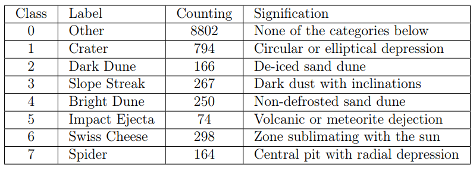
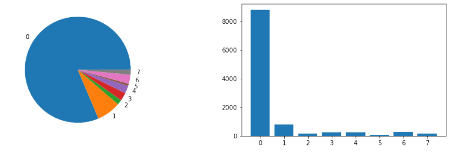
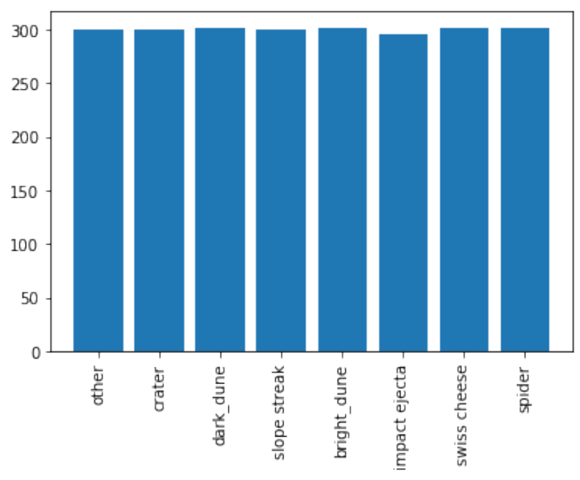
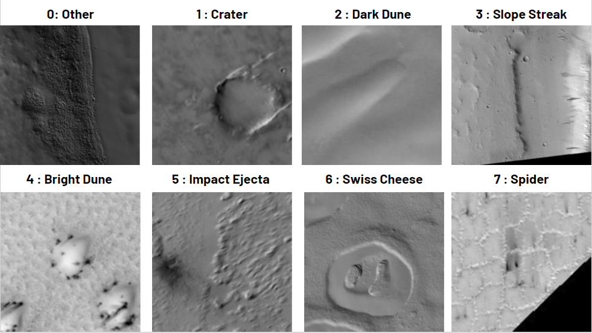
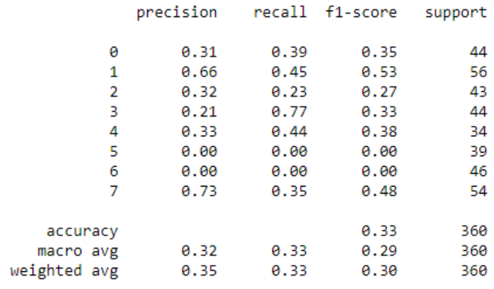
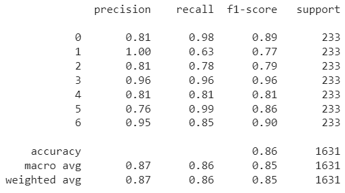
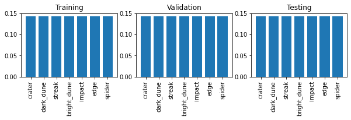

# Mars Image Classification


This project classifies grayscale HiRISE orbital images from the Mars Reconnaissance Orbiter. It uses an EfficientNetB0 model for seven annotated landmark classes: crater, dark dune, streak, bright dune, impact, edge, and spider. The dataset also contains an `other` class, which is excluded by default.

## Dataset

Use the [HiRISE v3.2 labeled dataset on Zenodo](https://doi.org/10.5281/zenodo.4002935), published by Gary Doran, Emily Dunkel, Steven Lu, and Kiri Wagstaff at NASA/JPL. Download `hirise-map-proj-v3_2.zip` (about 911 MB) and extract it under `data/`. The archive contains `map-proj-v3_2/` images and `labels-map-proj-v3_2_train_val_test.txt`, whose rows contain `filename class_id split`. The dataset has eight source labels (IDs 0–7); the package maps IDs 1–7 to stable zero-based model labels by default.

The training workflow follows the dataset's supplied split manifest and does no resampling for validation or test. Training uses inverse-frequency class weights. The results shown below were obtained using a random split and SMOTE applied separately to each split. This can place related images in different splits and makes validation/test scores describe synthetic data, so those metrics are not directly comparable to results from the documented workflow.

### Classes and dataset distribution

The dataset contains 10,815 source images. Their class counts show a strong imbalance, with `other` making up most of the data.

| ID | Class | Count | Description |
| ---: | --- | ---: | --- |
| 0 | Other | 8,802 | Catch-all for images outside the defined classes |
| 1 | Crater | 794 | Circular or elliptical depression |
| 2 | Dark dune | 166 | Defrosted sand dune |
| 3 | Slope streak | 267 | Dark dust feature on a slope |
| 4 | Bright dune | 250 | Frost-covered or non-defrosted sand dune |
| 5 | Impact ejecta | 74 | Material ejected by an impact or eruption |
| 6 | Swiss cheese / edge | 298 | The source data names this class Swiss cheese; the model label is `edge` |
| 7 | Spider | 164 | Polar feature with a central pit and radial troughs |



The charts below show the raw class imbalance and class distribution after balancing. They illustrate the class balance used for the reported experiments. The documented commands save each run's outputs under `outputs/`.





Example images from all eight source classes:



## Install

Python 3.10–3.12 is supported. Install the package and development tools in a virtual environment:

```bash
python -m venv .venv
# Windows: .venv\Scripts\activate
# macOS/Linux: source .venv/bin/activate
python -m pip install --upgrade pip
python -m pip install -e ".[train,dev]"
```

TensorFlow is an optional training/inference dependency. For GPU use, install the TensorFlow build and drivers supported by your operating system and accelerator; on Windows, current TensorFlow GPU workflows generally use WSL2. The default configuration requests ImageNet EfficientNetB0 weights, which are downloaded by Keras on the first training run. Set `weights` to `null` in a copied config for offline initialization. Unit tests do not import TensorFlow or download weights.

## Workflows

Check that the archive layout and all manifest images are present:

```bash
mars-classify prepare --data-dir data/hirise-map-proj-v3_2
```

Train using `configs/default.json`:

```bash
mars-classify train --config configs/default.json
```

Override settings directly on the command line, for example:

```bash
mars-classify train --config configs/default.json --data-dir data/hirise-map-proj-v3_2 --epochs 2 --batch-size 8 --seed 7 --device cpu --output-dir outputs/cpu-smoke --weights none
```

`--device` accepts `auto`, `cpu`, or `gpu`. `--weights none` selects random initialization; otherwise use a Keras EfficientNet weight value such as `imagenet`. Experiment settings include image size, batch size, epochs, learning rate, seed, model and output directory in JSON. The maintained architecture is EfficientNetB0 with the notebook's two dropout layers (0.8), global average pooling, and seven-class softmax. Inputs are resized to 227×227, converted to grayscale, replicated to three channels, and kept on the 0–255 scale expected by Keras EfficientNet preprocessing.

Evaluate a saved checkpoint on an official split (test is the default):

```bash
mars-classify evaluate --checkpoint outputs/default/best.keras --data-dir data/hirise-map-proj-v3_2 --split test
```

Predict one image or every supported image in a directory:

```bash
mars-classify predict --checkpoint outputs/default/best.keras --input path/to/image.png
mars-classify predict --checkpoint outputs/default/best.keras --input path/to/images/
```

Each run writes the resolved configuration, class mapping and preprocessing metadata, epoch history, validation metrics, and best `best.keras` model to its output directory. Checkpoint selection uses maximum validation accuracy. Evaluation reports accuracy, macro F1, support, and the confusion matrix. The `prepare` command validates; it does not download or extract the dataset.

## Code and notebooks

Reusable archive loading, preprocessing, model creation, training, evaluation, prediction, and CLI code live in `src/mars_image_classification/`. Run `mars-classify --help` for command options. `notebooks/Mars_Image_Classification.ipynb` contains exploratory analysis and plots; the package workflows run independently of Jupyter.

## Results and limitations

The reported experiments reached 86% accuracy on the balanced seven-class task without `other` and 33% on the task including it. These scores have not been reproduced with the documented commands. Validation and test were resampled separately, so the scores are not measurements on the official untouched splits. No performance result from the documented workflow is available yet.

The evaluation results below show the eight-class task (including `other`) and the seven-class task (excluding `other`). The screenshots use numeric labels: including `other`, IDs 0-7 follow the source IDs above; excluding it, IDs 0-6 correspond to crater, dark dune, slope streak, bright dune, impact ejecta, Swiss cheese/edge, and spider, respectively.



| Class (including other) | Precision | Recall | F1 | Support |
| --- | ---: | ---: | ---: | ---: |
| Other | 0.31 | 0.39 | 0.35 | 44 |
| Crater | 0.66 | 0.45 | 0.53 | 56 |
| Dark dune | 0.32 | 0.23 | 0.27 | 43 |
| Slope streak | 0.21 | 0.77 | 0.33 | 44 |
| Bright dune | 0.33 | 0.44 | 0.38 | 34 |
| Impact ejecta | 0.00 | 0.00 | 0.00 | 39 |
| Swiss cheese / edge | 0.00 | 0.00 | 0.00 | 46 |
| Spider | 0.73 | 0.35 | 0.48 | 54 |
| **Accuracy** |  |  | **0.33** | **360** |
| **Macro average** | **0.32** | **0.33** | **0.29** | **360** |
| **Weighted average** | **0.35** | **0.33** | **0.30** | **360** |



| Class (without other) | Precision | Recall | F1 | Support |
| --- | ---: | ---: | ---: | ---: |
| Crater | 0.81 | 0.98 | 0.89 | 233 |
| Dark dune | 1.00 | 0.63 | 0.77 | 233 |
| Slope streak | 0.81 | 0.78 | 0.79 | 233 |
| Bright dune | 0.96 | 0.96 | 0.96 | 233 |
| Impact ejecta | 0.81 | 0.81 | 0.81 | 233 |
| Swiss cheese / edge | 0.76 | 0.99 | 0.86 | 233 |
| Spider | 0.95 | 0.85 | 0.90 | 233 |
| **Accuracy** |  |  | **0.86** | **1,631** |
| **Macro average** | **0.87** | **0.86** | **0.85** | **1,631** |
| **Weighted average** | **0.87** | **0.86** | **0.85** | **1,631** |

The class distributions across the training, validation, and test sets are shown here:



Training is not deterministic across all TensorFlow versions, devices, and kernels. The package seeds Python, NumPy, and TensorFlow, but accelerator operations and data input can still introduce variation. The notebook also defines learning-rate variables that do not control the actual optimizer; the package uses the Adam learning rate documented in its config. Training can be computationally expensive, and pretrained weights require an initial download unless disabled.

## Development

```bash
python -m pip install -e ".[dev]"
python -m unittest discover -s tests
ruff check src tests
```

Dataset and run outputs are ignored by Git. No license is specified by this repository; consult the dataset record for data terms and retain its attribution when reusing the archive.
